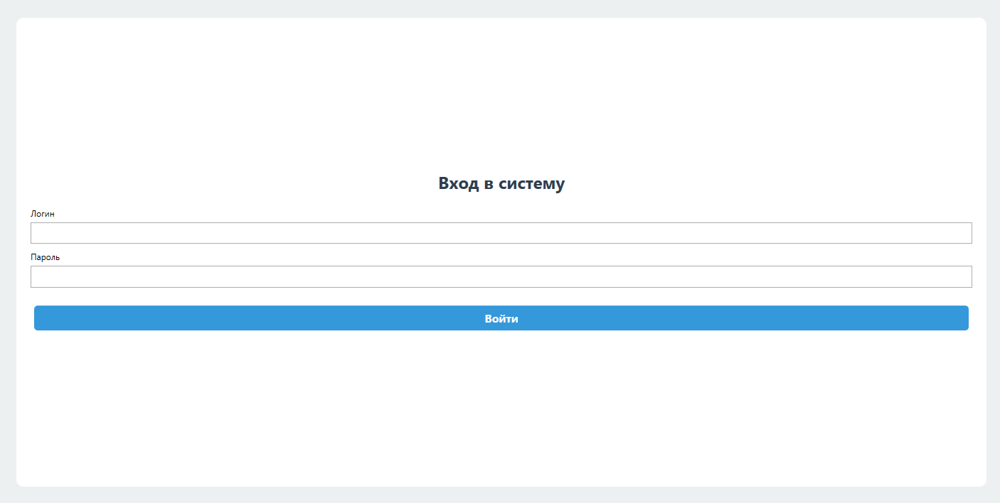
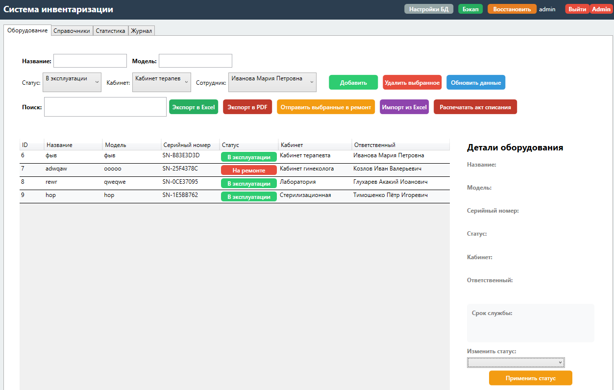
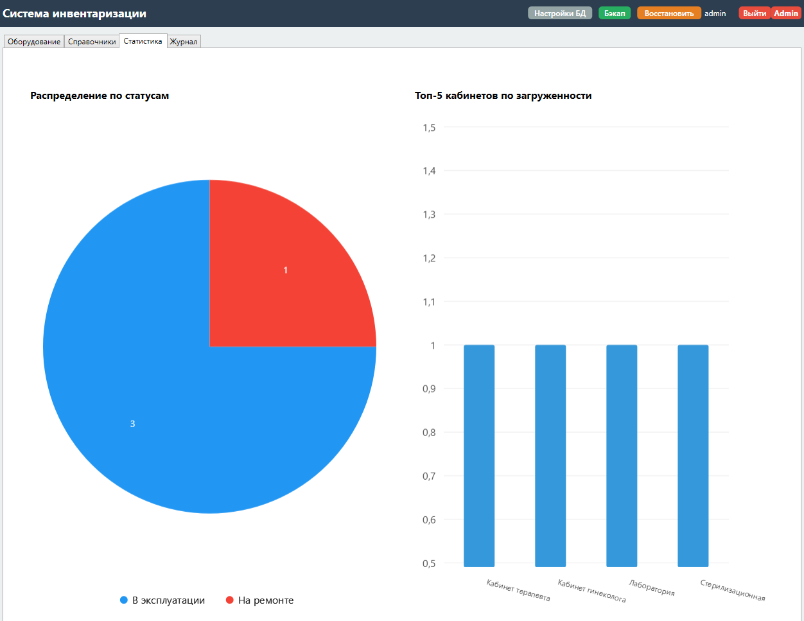

# InventoryOfEquipmentInAPolyclinic
inventory of equipment in a polyclinic / Система инвентаризации медицинского оборудования в поликлинике - учебный проект!!!

Учебный MVP-проект, представляющий собой десктопное приложение для учета и управления медицинским оборудованием в поликлинике.

## Описание проекта

Приложение разработано для автоматизации процессов инвентаризации. Оно позволяет вести учет оборудования, отслеживать его статус, закреплять за ответственными сотрудниками и кабинетами, а также формировать отчетную документацию!!!

### Основные возможности

- **Управление оборудованием (CRUD):** Добавление, редактирование (в том числе inline в таблице) и удаление записей.
- **Управление справочниками:** Ведение списков кабинетов, сотрудников, должностей и подразделений.
- **Ролевая модель:** Авторизация с разделением прав на администратора и обычного пользователя.
- **Визуализация данных:** Дашборд со статистикой и интерактивными графиками (распределение по статусам и кабинетам) на базе LiveCharts2.
- **Уведомления о сроках службы:** Автоматическая подсветка оборудования, срок службы которого истекает или уже истек.
- **Журнал действий (Audit Log):** Фиксация всех изменений в системе с указанием пользователя и времени.
- **Экспорт данных:** Выгрузка списка оборудования в форматы Excel (.xlsx) и PDF.
- **Импорт данных:** Пакетная загрузка оборудования из файлов Excel.
- **Генерация документов:** Автоматическое формирование акта списания оборудования в формате PDF.
- **Резервное копирование:** Создание и восстановление базы данных из JSON-файла.
- **Гибкая настройка:** Возможность изменения строки подключения к базе данных через интерфейс.

## Технологический стек

- **Язык программирования:** C# (.NET 8)
- **Пользовательский интерфейс:** WPF (Windows Presentation Foundation)
- **Архитектурный паттерн:** MVVM (Model-View-ViewModel)
- **ORM:** Entity Framework Core
- **СУБД:** MariaDB
- **Сторонние библиотеки:**
  - `CommunityToolkit.Mvvm` (реализация MVVM)
  - `ClosedXML` (работа с Excel)
  - `QuestPDF` (генерация PDF)
  - `LiveChartsCore.SkiaSharpView.WPF` (графики)
  - `Microsoft.Extensions.Configuration.Json` (чтение конфигурации)

## Структура базы данных

База данных состоит из нескольких связанных таблиц:
- `Equipments` (Оборудование)
- `Cabinets` (Кабинеты)
- `Employees` (Сотрудники)
- `Statuses` (Статусы оборудования)
- `Positions` (Должности)
- `Departments` (Подразделения)
- `Addresses` (Адреса)
- `Users` (Пользователи системы)
- `AuditLogs` (Журнал действий)

Связи между таблицами реализованы через внешние ключи (Foreign Keys).

## Установка и запуск

1. Клонируйте репозиторий.
2. Убедитесь, что на компьютере установлен сервер MariaDB (или MySQL).
3. Создайте пустую базу данных с именем `clinic_inventory`.
4. В файле `appsettings.json` укажите корректную строку подключения к вашей базе данных:
   ```json
   {
     "ConnectionStrings": {
       "DefaultConnection": "Server=localhost;Port=3306;Database=clinic_inventory;User=root;Password=ваш_пароль;"
     }
   }
5. Примените миграции для создания структуры БД. В консоли диспетчера пакетов выполните: Update-Database

## Учетные данные по умолчанию
После применения миграций в базе данных будут созданы два пользователя:

Администратор: Логин: admin, Пароль: admin123

Пользователь: Логин: user, Пароль: user123

Окно авторизации

<div align="center">
  
</div>

Главное окно со списком оборудования

<div align="center">
  
</div>

Статистика и графики

<div align="center">
  
</div>